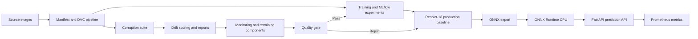

# Pet Breed MLOps

An end-to-end MLOps project for 37-class pet breed classification, featuring reproducible data preparation, ResNet model experiments, confidence calibration, ONNX CPU inference, API monitoring, and drift detection.

## Production inference

The current API deployment uses **ResNet-18 exported to ONNX and ONNX Runtime CPU**. TensorRT and a GPU are not required to run this deployment.

### Run with Docker

Prerequisites: Docker Desktop running.

Build the image from the repository root:

```powershell
docker build -t bet-breed-api:onnx-cpu .
```

Start the API:

```powershell
docker run -d --name bet-breed-api -p 8000:8000 bet-breed-api:onnx-cpu
```

Check health:

```powershell
Invoke-RestMethod http://localhost:8000/health
```

Expected response includes:

```json
{
  "status": "healthy",
  "model_version": "resnet18-onnx-cpu-v1",
  "num_classes": 37
}
```

### API endpoints

| Endpoint | Purpose |
|---|---|
| `GET /health` | Reports service health, model version, and class count |
| `POST /predict` | Accepts an image as multipart form data using the `file` field |
| `GET /metrics` | Exposes Prometheus metrics |

Example prediction response fields include `filename`, `breed`, `species`, `confidence`, `top_3`, `decision`, `model_version`, `threshold`, `status`, and `class_id`.

The current confidence threshold is `0.80`. Predictions below the threshold can be marked as uncertain rather than presented as confident classifications.

### Run locally

Use the project's `uv` environment and ensure the `src` directory is available on `PYTHONPATH`.

```powershell
$env:PYTHONPATH = "$PWD\src"
uv run uvicorn bet_breed_mlops.api:app --host 127.0.0.1 --port 8000
```

## Dataset and reproducibility

- Oxford-IIIT Pet is organized into training, validation, and test splits.
- The split uses a fixed seed and stratification.
- The test split is reserved for final evaluation; validation results should not be described as independent test results.
- A manifest records image metadata, class indices, splits, and corruption information.
- DVC tracks dataset and generated-artifact pointers, with pipeline stages defined in `dvc.yaml`.

The configured development DVC remote is `D:\DVC_Remote`. This is a local path, not an accessible remote for GitHub-hosted runners. Remote setup and end-to-end CI restoration remain pending.

## Models and evaluation

ResNet-18 is the current production baseline. Experiments include ResNet-18, ResNet-50, and MobileNetV3-Small.

- Confidence calibration uses temperature scaling and an abstention threshold.
- The quality gate compares a candidate model with the production baseline and rejects a top-1 accuracy drop beyond the configured tolerance.
- MLflow experiment comparisons and evaluation reports are maintained under `reports/`.
- The ONNX CPU inference path is the current API serving path.

Calibration and threshold selection use validation data. Coverage and selective-accuracy measurements based on that split are validation estimates, not independent test-set estimates.

## Monitoring and drift

The project includes batch-scoring and drift-monitoring components for image corruption, image statistics, embeddings, and confidence distributions.

- The FastAPI service exposes Prometheus metrics at `/metrics`.
- Prometheus and Grafana configuration is provided under `monitoring/`.
- Drift scoring, reporting, and retraining orchestration components are included in the repository.

Configuration files and scripts do not by themselves establish that Prometheus, Grafana, or Airflow have been deployed and successfully run end to end. Live infrastructure validation remains separate from local API testing.

## Optimization experiments

The repository contains optimization and benchmarking scripts for comparing inference approaches. Measurements should be interpreted in the context of their hardware, runtime, batch size, and measurement methodology; CPU and GPU results are not directly comparable as device-only performance comparisons.

TensorRT artifacts and scripts, if retained, are experimental artifacts and are not prerequisites for the current ONNX CPU deployment.

## CI/CD and deployment status

The GitHub Actions workflow is present in the repository, but end-to-end CI/CD validation and configuration of a GitHub-accessible DVC remote are pending.

A clean checkout cannot be assumed to have all DVC-managed datasets and model artifacts until the remote is configured and those artifacts can be restored. Configure the repository's `DVC_REMOTE_URL` secret only after an accessible remote is available.

## Architecture



## Validation performed

Local validation performed for the current CPU deployment:

- Automated project tests passed in the local environment.
- Docker container started successfully.
- `GET /health` returned `healthy` with 37 classes.
- `POST /predict` returned HTTP 200 with breed, species, confidence, top-three predictions, decision, and model version.
- `GET /metrics` exposed Prometheus latency metrics.

These checks validate the local API path; they do not claim that the GitHub Actions workflow, remote DVC restoration, or external monitoring infrastructure has passed an end-to-end deployment test.

See `reports/copilot_implementation_report.md` and the other available reports for additional implementation and evaluation details.
